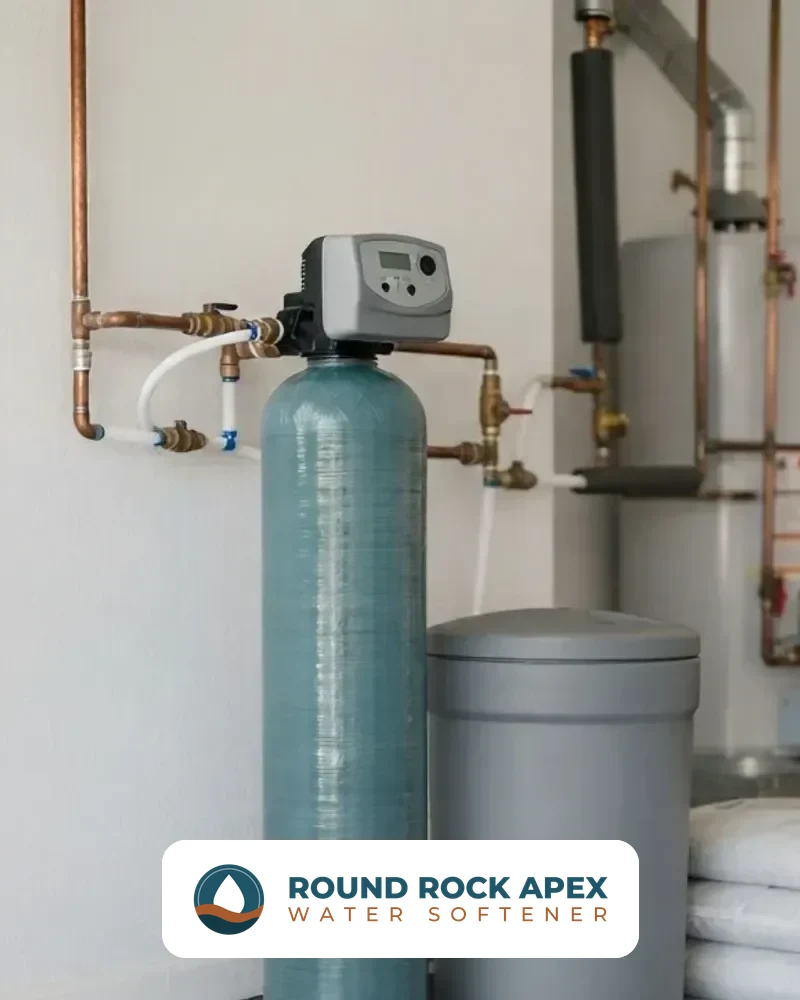
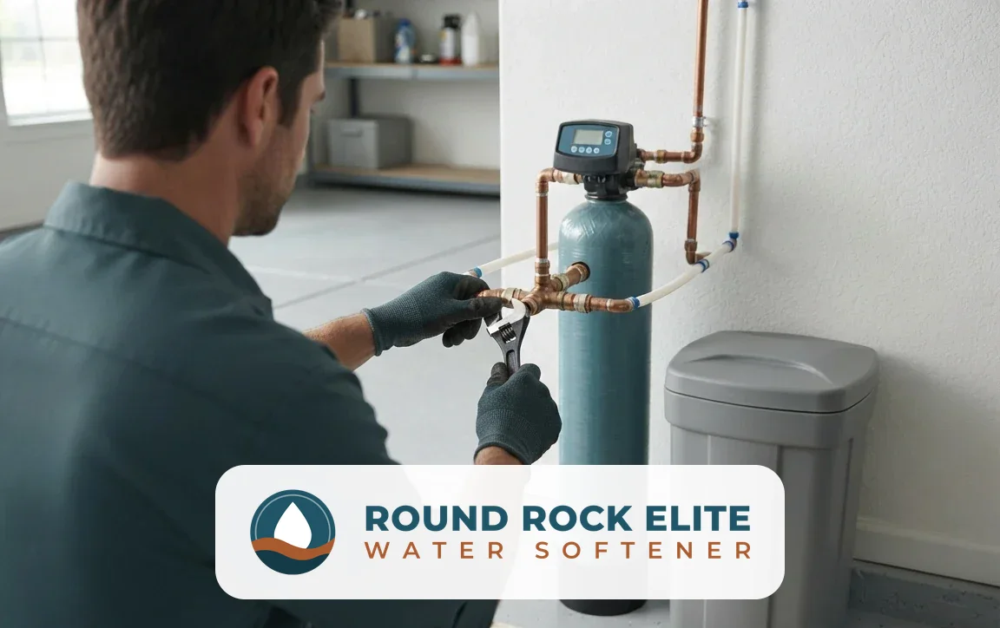
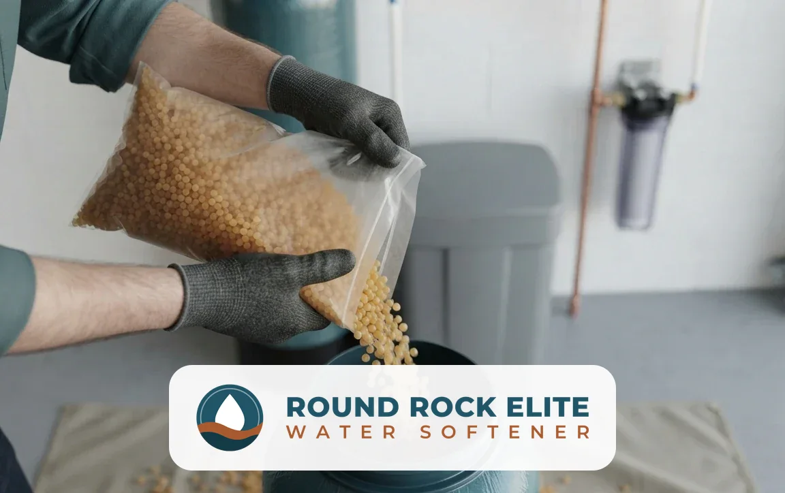
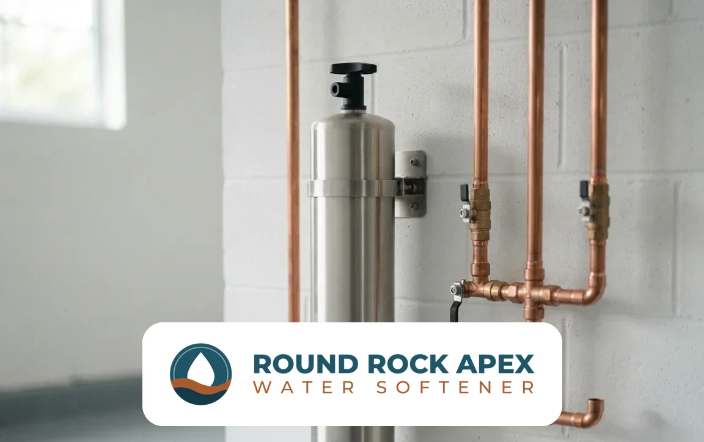
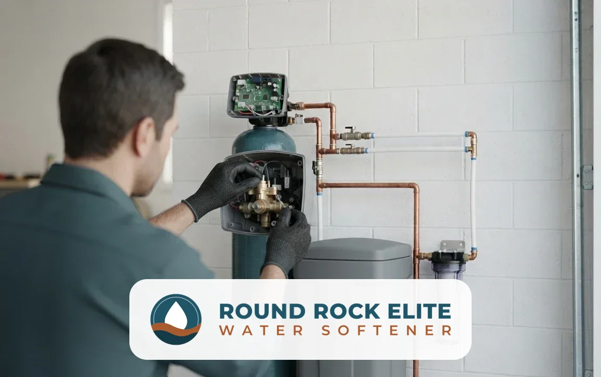
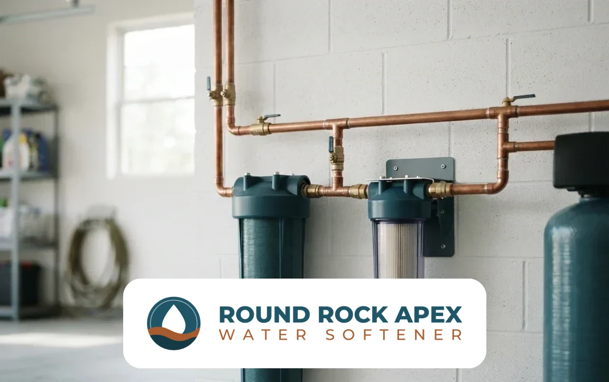
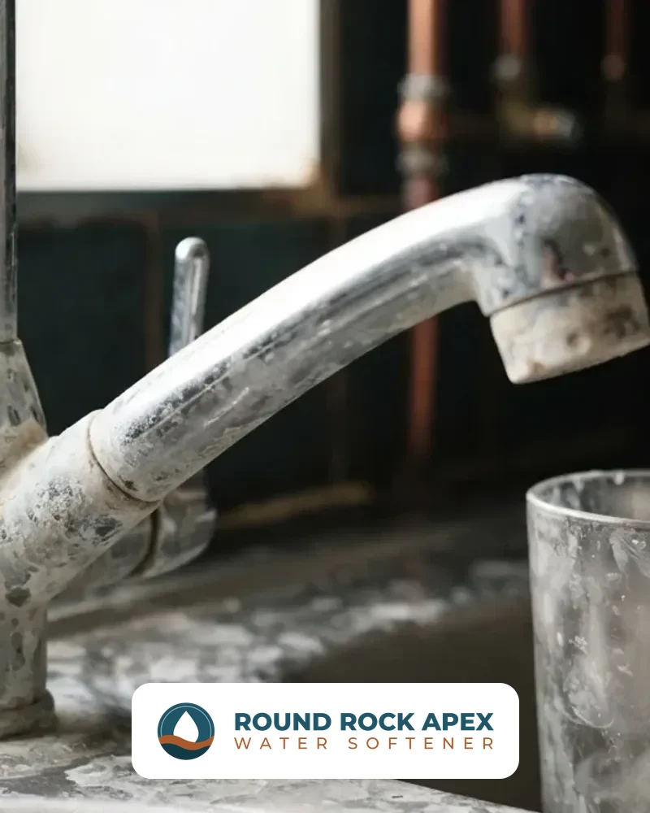

## Why Are We the Best Water Softener Installation Company in Round Rock, TX?

Homeowners choose a water softener company on five things: who does the work, how the system is backed, how fast help arrives, whether the installer knows local water, and what the estimate includes. Use these six checks with any company, this one included.

- **Licence:** Ask any installer for the licence number Texas requires for the work and for proof of insurance before work starts.
- **Warranty:** The estimate states the warranty on the equipment and on the labor. Read it before you approve the work.
- **Sizing by test:** A correct system size comes from a hardness test and your household's daily water use, not from a standard package.
- **Local water knowledge:** The City of Round Rock blends surface water from Lake Georgetown and Lake Travis with Edwards Aquifer groundwater, and its 2025 results table lists hardness from 100 to 358 ppm, so the number changes with the tap.
- **Scheduling:** Ask how quickly the installer can fit your job in. Same-day service depends on technician availability.
- **Itemized estimate:** The estimate lists the unit, the plumbing work and the labor, so you see what is included before work starts.

[Request Your Free Estimate](#estimate)

## What Water Softener Services Are Available in Round Rock, TX?

Round Rock Elite Water Softener covers six core services, from first installation to long-term maintenance, and adds specialty systems for larger homes, businesses and wells.

### Water Softener Installation

Installation connects a new softener to your home's main water line so every faucet, shower and appliance receives softened water. The unit is sized to your household and water use, fitted with a bypass valve, connected to a drain and brine line, programmed and tested at every tap before the technician leaves.

### Water Softener Replacement

Replacement removes an old or failing softener and installs a new, correctly sized unit on the existing plumbing. It covers full system replacement, resin bed replacement and upgrades for systems that no longer soften, leak, or cost more to repair than they are worth.

### Salt-Free Water Softener Systems

A salt-free system conditions hard water so scale no longer clings to pipes and fixtures. It does not remove calcium and magnesium, needs no salt and no drain line, and fits homeowners who want lower maintenance over full softening.

### Water Softener Repair & Service

Repair and service restores softeners that stop regenerating, leave hard water, run out of salt too fast or leak at the control head. Routine service includes resin and brine tank checks, cleaning, salt refills and valve testing.

### Whole House Water Filtration

Whole house filtration treats water where it enters the home, reducing chlorine taste and sediment before it reaches every tap. It pairs with a softener because filtration and softening solve different problems.

### Water Quality Testing

A water quality test measures hardness, iron, pH, total dissolved solids and other values that decide which system fits. It is the first step of every recommendation.

Dual tank and commercial water softeners, water conditioners, reverse osmosis and UV purification, drinking water systems, well water treatment and contaminant removal filters are also available.

## Why Is Round Rock Water So Hard?

Round Rock water is hard because the lakes and aquifer it draws from sit in limestone country. According to a 1987 U.S. Geological Survey report by M. E. Dorsey and Diana L. Slagle titled “Hydrologic and Geologic Data for the Edwards Aquifer Recharge Zone near Georgetown, Williamson County, Texas, 1986-87,” the Edwards aquifer in that area includes the Edwards Limestone, the overlying Georgetown Limestone and the underlying Comanche Peak Limestone. The same report measured dissolved solids from 320 to 1,300 milligrams per liter in samples from selected wells and from 251 to 290 milligrams per liter in samples from selected streams.

### Where Does Round Rock Water Come From?

According to the City of Round Rock's 2025 water quality report, surface water is primarily supplied by Lake Georgetown and groundwater comes from the Edwards Aquifer. The City also obtains surface water from Lake Travis, where the Brushy Creek Regional Utility Authority, owned by Round Rock and two other regional partners, treats it.

### Why Does Limestone Make Water Hard?

Water that has moved through limestone picks up dissolved calcium and magnesium, and those two minerals define hardness. The City of Round Rock says its sources naturally contain dissolved limestone and other mineral-bearing rock formations common throughout Central Texas.

### How Is Water Hardness Measured?

Hardness is measured in milligrams per liter (mg/L) or grains per gallon (gpg), where 1 gpg equals about 17.1 mg/L. The U.S. Geological Survey rates water under 60 mg/L as soft, 61 to 120 mg/L as moderately hard, 121 to 180 mg/L as hard and anything over 180 mg/L as very hard.

### How Hard Is Round Rock Water?

The City of Round Rock's 2025 water quality report put average hardness at 249 mg/L, about 14.6 grains per gallon, and calls it very hard water. Its results table lists hardness from 100 to 358 ppm, about 5.8 to 20.9 grains per gallon, with an average of 258 ppm.

### What Does the City's Water Quality Report Show?

The City disinfects with chloramine and reported an average residual of 2.15 ppm in 2025, under the 4 ppm limit, with an average pH of 7.53 and an average calcium level of 70 ppm. Texas rates the system superior, its highest rating, and hardness itself is a household problem: scale narrows pipes, coats heating elements and spots glass.

### How Do You Find Your Exact Hardness?

A free water test shows the exact reading at your tap, because the supply blend and home plumbing both move the number.

